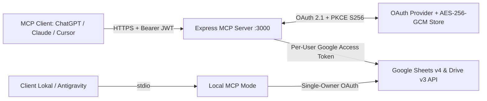

# Google Sheets MCP Server

Server **Model Context Protocol (MCP)** berbasis Node.js untuk menghubungkan asisten AI (**ChatGPT**, **Claude**, **Cursor**, **Antigravity**, dan client MCP lainnya) ke **Google Sheets** secara aman.

Mendukung dua mode sekaligus:
- **Multi-User Public OAuth 2.1 (`MCP_AUTH_MODE=multiuser`)** — setiap pengguna login dengan akun Google masing-masing untuk mengakses spreadsheet milik mereka sendiri.
- **Single-Owner Lokal / Private (`stdio` atau `external-oidc`)** — untuk penggunaan pribadi dengan allowlist ID spreadsheet tetap.

---

## 1. Cara Langsung Pakai (Tanpa Install / Tanpa Self-Host)

Jika Anda ingin langsung memakai server publik yang sudah online tanpa konfigurasi Google Cloud sendiri:

- **Portal Koneksi Interaktif (1-Klik):** [https://sheets-mcp.allbase.my.id/](https://sheets-mcp.allbase.my.id/)
- **MCP Endpoint (`Streamable HTTP`):** `https://sheets-mcp.allbase.my.id/mcp`

Buka **[Portal Koneksi](https://sheets-mcp.allbase.my.id/)** di browser untuk langsung:
1. Menyalin endpoint atau memasang konfigurasi **1-klik** sesuai aplikasi Anda (**ChatGPT**, **Claude**, **Cursor deep-link**, **Antigravity IDE** Windows/macOS/Linux, **Claude Code**, dan client MCP generik).
2. Memilih autentikasi **OAuth** *(Dynamic Client Registration & Client ID Metadata Document / CIMD didukung otomatis)*.
3. Login menggunakan **akun Google Anda sendiri** pada layar izin Google *(jika muncul peringatan `"Google hasn't verified this app"`, pilih **Advanced -> Go to sheets-mcp.allbase.my.id (unsafe)** lalu centang izin akses)*.
4. Menguji kesiapan server langsung lewat tombol **Cek Status Server** (`/healthz`) sebelum mulai membaca/menulis Google Sheets lewat AI.

> **Halaman Informasi:** [Portal Koneksi](https://sheets-mcp.allbase.my.id/) · [Privacy Policy](https://sheets-mcp.allbase.my.id/privacy) · [Terms of Service](https://sheets-mcp.allbase.my.id/terms)

---

## 2. Daftar Tools & Parameter

Server menyediakan **7 tool** (tool tulis aktif ketika `ENABLE_WRITES=true` dan `GOOGLE_SCOPE_MODE=readwrite`):

| Tool | Kategori | Deskripsi | Parameter Utama |
| --- | --- | --- | --- |
| `list_spreadsheets` | Baca | Menampilkan daftar spreadsheet milik akun Google yang login (bisa difilter judul) atau allowlist | `query?`, `maxResults?` (`1–50`) |
| `list_tabs` | Baca | Memverifikasi akses spreadsheet dan melihat daftar tab, ID, ukuran grid, serta locale | `spreadsheetId` (ID atau URL Sheets) |
| `read_sheet` | Baca | Membaca rentang sel terbatas (`A1:D20`) sebagai nilai tampilan, nilai mentah, atau rumus | `spreadsheetId`, `sheet`, `range`, `render?` |
| `write_cells` | Tulis | Menimpa sel pada rentang persegi panjang exact dengan mode `RAW` (string `""` menghapus isi sel) | `spreadsheetId`, `sheet`, `range`, `values`, `confirm` |
| `append_rows` | Tulis | Menambahkan baris baru setelah tabel logis di dalam `tableRange` | `spreadsheetId`, `sheet`, `tableRange`, `values`, `confirm` |
| `create_tab` | Tulis | Membuat 1 tab baru (default 1.000 baris, 26 kolom) pada spreadsheet yang ada | `spreadsheetId`, `title`, `confirm` |
| `set_formula` | Tulis | Mengisi 1 sel dengan rumus Google Sheets (`USER_ENTERED`, harus diawali `=`) | `spreadsheetId`, `sheet`, `cell`, `formula`, `confirm` |

### Batasan & Pengamanan Bawaan
- **Tanpa tool destruktif tingkat file:** tidak tersedia tool untuk menghapus file, mengubah sharing/permission Google Drive, atau membuat file spreadsheet baru.
- **Batas payload & sel:** default maksimal **`5.000` sel** (`MAX_CELLS`), **`10.000` karakter** per sel/rumus, dan **`200 KB`** ukuran respons per panggilan (`MAX_RESPONSE_BYTES`).
- **Validasi input ketat:** rentang harus berbatas (`A1:D20`, menolak seluruh kolom seperti `A:A`), penulisan teks memakai mode `RAW` agar teks tidak berubah menjadi rumus liar, dan setiap operasi tulis membutuhkan `confirm: true` setelah persetujuan pengguna.

---

## 3. Arsitektur & Model Keamanan



Keamanan pada mode **Multi-User (`MCP_AUTH_MODE=multiuser`)**:
- **Isolasi Per-Pengguna:** setiap pengguna memiliki grant & token Google terpisah (`userId` dari Google `sub`); pengguna A tidak bisa mengakses spreadsheet pengguna B.
- **Enkripsi Token at Rest:** store OAuth (`.data/oauth-store.json`) dienkripsi memakai **AES-256-GCM** dengan derivasi kunci **HKDF-SHA256** dari `.secrets/master.key` (atau `MCP_TOKEN_SECRET`), dan JWT internal ditandatangani **HS256**.
- **OAuth 2.1 Modern:** mendukung PKCE (`S256`), `resource` indicator validation (RFC 8707), metadata RFC 9728 (`/.well-known/oauth-protected-resource/mcp`) & RFC 8414 (`/.well-known/oauth-authorization-server`), DCR (`/register`), dan CIMD dengan proteksi **SSRF** (memblokir IP privat/loopback/link-local/CGNAT).
- **HTTP Hardening:** validasi `Host` & `Origin`, `trust proxy` terkontrol, CSP & security headers, serta rate limiting per IP pada endpoint OAuth & MCP.

---

## 4. Endpoint HTTP Publik

| Endpoint | Fungsi |
| --- | --- |
| `GET /` | Portal onboarding interaktif 1-klik (`text/html` dengan CSP nonce, dukungan tema Light/Dark) atau metadata JSON (`Accept: application/json`) |
| `GET /privacy` · `GET /terms` | Privacy Policy & Terms of Service untuk OAuth Consent Screen |
| `GET /healthz` | Status kesehatan server (`authMode`, `writesEnabled`, `googleConnection`) |
| `GET /.well-known/oauth-protected-resource/mcp` | Metadata resource server (RFC 9728) |
| `GET /.well-known/oauth-authorization-server` | Metadata OAuth 2.1 Authorization Server (RFC 8414) |
| `POST /register` · `GET/POST /authorize` · `POST /token` · `POST /revoke` | Endpoint OAuth 2.1 Client Registration, Authorization, Token, dan Revocation |
| `GET /oauth/google/callback` | Callback OAuth 2.0 dari Google |
| `POST /mcp` | Endpoint Streamable HTTP MCP (dilindungi Bearer JWT; mengembalikan `401` + `WWW-Authenticate` jika tanpa token) |

---

## 5. Self-Hosting Publik (VPS Linux + Cloudflare Tunnel + PM2)

### Prasyarat
- **Node.js `>= 22.0.0`**
- **Google Cloud Project** dengan **Google Sheets API** dan **Google Drive API** diaktifkan
- **OAuth 2.0 Client (Web application)** dengan Authorized redirect URI:
  `https://<domain-anda>/oauth/google/callback`
- Domain dengan reverse proxy HTTPS (misalnya **Cloudflare Tunnel** atau Nginx/Caddy) ke `http://127.0.0.1:3000`

### Langkah Setup
```bash
git clone https://github.com/IlalIlhamdi/google-sheets-mcp.git
cd google-sheets-mcp
npm ci --no-audit --no-fund
npm run configure:public
```

Jalankan pemeriksaan sebelum online:
```bash
npm run doctor -- --remote
```

Jalankan di background dengan PM2 (`ecosystem.config.cjs`):
```bash
npm install -g pm2
pm2 start ecosystem.config.cjs
pm2 save
```

Daftar lengkap environment variable dapat dilihat di [`.env.example`](.env.example).

---

## 6. Pengujian & Verifikasi

```bash
npm run check   # Cek sintaks seluruh file JavaScript (.mjs)
npm test        # Jalankan unit & integration test (termasuk simulasi alur multi-user OAuth)
```

---

## 7. Dokumentasi Tambahan

- [docs/WINDOWS11.md](docs/WINDOWS11.md) — Setup lokal di Windows 11 & Antigravity (`stdio`)
- [docs/CHATGPT-REMOTE.md](docs/CHATGPT-REMOTE.md) — Setup remote mode single-owner
- [docs/SECURITY.md](docs/SECURITY.md) — Detail arsitektur keamanan & manajemen kredensial
- [docs/TROUBLESHOOTING.md](docs/TROUBLESHOOTING.md) — Panduan mengatasi masalah umum
