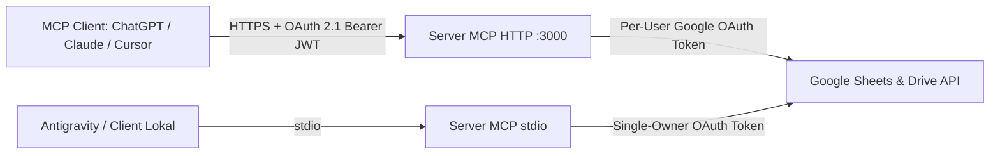

# Google Sheets MCP Server

Server **Model Context Protocol (MCP)** untuk membaca dan mengedit Google Sheets secara aman melalui **Streamable HTTP (Multi-User OAuth 2.1)** maupun **stdio / HTTP mode satu pengguna**.

## Cara Langsung Pakai (Hosted Endpoint)

Jika Anda hanya ingin langsung menghubungkan MCP client (ChatGPT, Claude, Cursor, Antigravity, atau MCP Inspector) tanpa self-host sendiri:

```text
https://sheets-mcp.allbase.my.id/mcp
```

1. Tambahkan URL di atas sebagai **Custom / Remote MCP Server** di client MCP Anda.
2. Pilih metode autentikasi **OAuth** (Dynamic Client Registration & CIMD didukung).
3. Login dengan **akun Google Anda masing-masing** untuk memberi izin akses spreadsheet Anda sendiri.

> **Privasi & Ketentuan:** [Privacy Policy](https://sheets-mcp.allbase.my.id/privacy) · [Terms of Service](https://sheets-mcp.allbase.my.id/terms)

---

## Fitur & Tools

| Tool | Fungsi | Mode |
| --- | --- | --- |
| `list_spreadsheets` | Daftar spreadsheet milik pengguna via Google Drive API (`drive.metadata.readonly`) atau `ALLOWED_SPREADSHEET_IDS` | Read / ReadWrite |
| `list_tabs` | Cek akses spreadsheet dan daftar tab, judul, ukuran, serta locale | Read / ReadWrite |
| `read_sheet` | Baca rentang sel terbatas (mis. `A1:D20`), nilai atau rumus | Read / ReadWrite |
| `write_cells` | Timpa sel dengan nilai `RAW` | ReadWrite (`ENABLE_WRITES=true`) |
| `append_rows` | Tambah baris setelah tabel yang dideteksi Google | ReadWrite (`ENABLE_WRITES=true`) |
| `create_tab` | Buat tab baru dalam spreadsheet yang sudah ada | ReadWrite (`ENABLE_WRITES=true`) |
| `set_formula` | Timpa satu sel dengan rumus (`USER_ENTERED`) | ReadWrite (`ENABLE_WRITES=true`) |

Batasan keamanan bawaan: tidak ada tool untuk menghapus file, mengubah sharing/permission Drive, atau membuat file Drive baru. Rentang baca/tulis dibatasi (default maksimal `5.000` sel dan `200 KB` payload per panggilan).

---

## Mode Pengoperasian



1. **Multi-User Public OAuth 2.1 (`MCP_AUTH_MODE=multiuser`):** setiap pengguna login dengan akun Google masing-masing, token Google terenkripsi **AES-256-GCM** di disk (`.data/oauth-store.json`), dengan proteksi PKCE `S256`, validasi CIMD SSRF, dan rate limiting.
2. **Single-Owner Lokal / Tunnel (`MCP_AUTH_MODE=external-oidc` atau `stdio`):** untuk pemakaian pribadi dengan `ALLOWED_SPREADSHEET_IDS` yang dikunci.

---

## Self-Hosting Publik (Linux VPS + Cloudflare Tunnel + PM2)

Persyaratan: Node.js `>= 22.0.0`, Google Cloud project dengan **Google Sheets API** dan **Google Drive API** aktif, serta Google OAuth **Web application** client.

```bash
git clone https://github.com/IlalIlhamdi/google-sheets-mcp.git
cd google-sheets-mcp
npm ci --no-audit --no-fund
npm run configure:public
```

Perintah `npm run configure:public` akan membuat file `.env` dan master key di `.secrets/`, lalu Anda tinggal:
- Tambahkan Authorized redirect URI `https://<domain-anda>/oauth/google/callback` di Google Cloud Console.
- Verifikasi konfigurasi: `npm run doctor -- --remote`
- Jalankan dengan PM2: `pm2 start ecosystem.config.cjs && pm2 save`
- Arahkan reverse proxy HTTPS / Cloudflare Tunnel ke `http://127.0.0.1:3000`.

Variabel konfigurasi lengkap tersedia di [`.env.example`](.env.example).

---

## Pengujian & Verifikasi Lokal

```bash
npm run check
npm test
```

Panduan lanjutan tersedia di:
- [docs/WINDOWS11.md](docs/WINDOWS11.md) — Pemakaian lokal di Windows 11 & Antigravity (`stdio`)
- [docs/CHATGPT-REMOTE.md](docs/CHATGPT-REMOTE.md) — Mode remote single-owner
- [docs/SECURITY.md](docs/SECURITY.md) — Model keamanan & proteksi token
- [docs/TROUBLESHOOTING.md](docs/TROUBLESHOOTING.md) — Penanganan masalah umum
